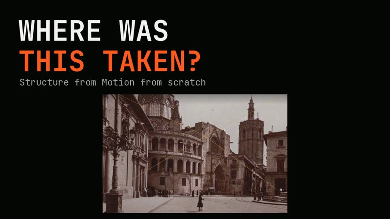
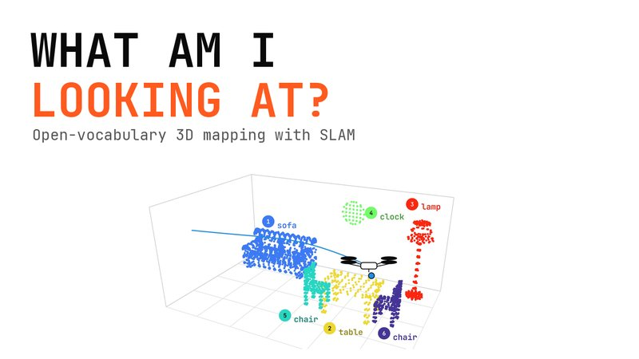
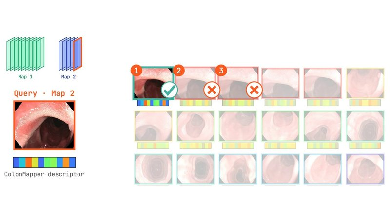
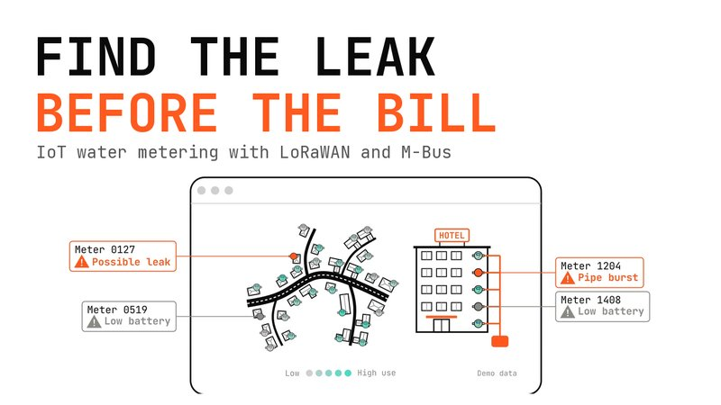
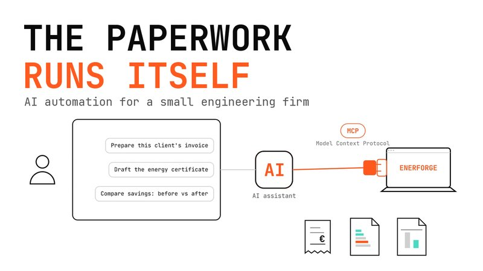

<picture>
  <source media="(prefers-color-scheme: dark)" srcset="assets/terminal-dark.svg">
  
</picture>

<a href="https://davidpadilla.eu"><picture><source media="(prefers-color-scheme: dark)" srcset="assets/buttons/key-website-dark.svg"></picture></a>
<a href="https://www.linkedin.com/in/david-padilla-orenga/"><picture><source media="(prefers-color-scheme: dark)" srcset="assets/buttons/key-linkedin-dark.svg"></picture></a>
<a href="mailto:me@davidpadilla.eu"><picture><source media="(prefers-color-scheme: dark)" srcset="assets/buttons/key-email-dark.svg"></picture></a>

I build systems that bring AI into the real world. Some of them **see**: cameras that inspect, count and measure,
3D models rebuilt from photos or video, maps a robot can query in plain language. Others **read and act**: LLMs and
agents that sort a company's paperwork, connect to its own tools and take repetitive work off the team, always with a
human in the loop. Every project starts with the problem, not the tool, and ends with something running on real
hardware and real data.

Most of my work is for companies and lives in private repositories. What's public here is the part I can share, and
the projects I can talk about are written up on **[davidpadilla.eu](https://davidpadilla.eu/en/projects/)**.

<picture>
  <source media="(prefers-color-scheme: dark)" srcset="assets/services-dark.svg">
  
</picture>

**`see/`** · Inspection, counting and tracking tuned to your own cameras, and machines that understand a 3D space: what's
in it, where everything is and how it all fits together. Then the model is optimised to run fast on the hardware you
already have.

**`think-and-act/`** · Models trained on your own data to classify, predict or decide, and **LLMs and agents** that take
multi-step tasks from start to finish, connected to your own tools and data and always under your control. The
repetitive paperwork, automated.

**`connect/`** · From sensor to screen: sensors, gateways and a platform that show what your equipment is doing as it
happens, and digital twins that alert you the moment something fails and use their history to see what's coming.

<picture>
  <source media="(prefers-color-scheme: dark)" srcset="assets/toolbox-dark.svg">
  
</picture>

Python and C++ for the heavy lifting, PyTorch and CUDA to train and run models, OpenCV, Open3D and COLMAP for vision
and 3D, and LLMs and agents when the work is about documents and processes. The tool follows the problem, never the
other way round. I learned that the hard way, as an engineer in industry long before I specialised in AI. Want to
know more about my career path and where that experience comes from? **[It's all on my
website](https://davidpadilla.eu/en/about/)**.

Tools are only half the story; what counts is what they end up doing. Most of my projects run inside companies and
research groups, on their hardware and with their data, so the code stays with them and the story goes into a case
study: the problem, the decisions and the result. A few are open source, and those are here in full, to read, run and
build on.

<picture>
  <source media="(prefers-color-scheme: dark)" srcset="assets/repos-dark.svg">
  
</picture>

Behind every name there's **a real problem** that needed solving. The table below sums each one up in a line, so you can
quickly find **the ones closest to what you're working on**. From there, open the code if it's public, or read the case
study for the whole picture: why it was hard, what I chose and what came out of it.

| | Project | What it is |
|---|---|---|
|  | **`sfmkit`** Open source | Structure from Motion from scratch, to locate historical photos. Scored against COLMAP. [Code](https://github.com/dpadillaor/sfmkit) · [Docs](https://dpadillaor.github.io/sfmkit/) · [Case study](https://davidpadilla.eu/en/projects/sfm-valencia-cathedral/) |
|  | **`OVO`** Open source | Open-vocabulary 3D semantic mapping with SLAM, with consistent object instances. [Code](https://github.com/dpadillaor/OVO) · [Case study](https://davidpadilla.eu/en/projects/ovo-3d-instances/) |
|  | **`endoscopy-place-recognition`** Private | Deep-learning place recognition in a real-time endoscopic SLAM, in C++. [Case study](https://davidpadilla.eu/en/projects/endoscopy-place-recognition/) |
|  | **`water-meter-iot-platform`** Private | IoT platform for the remote reading and monitoring of water meters. [Case study](https://davidpadilla.eu/en/projects/water-meter-iot-platform/) |
|  | **`enerforge-automation`** Private | AI-powered digitalisation and automation of an engineering firm. [Case study](https://davidpadilla.eu/en/projects/enerforge-automation/) |

Every project starts the same way: **a conversation about the problem**, before anyone mentions a model or a framework.
From there comes a plan with **clear milestones**, so it's always obvious what comes next and when. Then the building, in
steps you can see and test along the way, until it **runs on your hardware, with your data**, documented so your team can
own it.

So if you've got an idea going round your head, even a rough one, **I'd genuinely like to hear it.** Sometimes it turns
into a project, sometimes it's just a good conversation. Either way, it's worth having. The same goes for **open source
and community work**: if you're building something in the open, I'm always up for joining in.

<picture>
  <source media="(prefers-color-scheme: dark)" srcset="https://raw.githubusercontent.com/dpadillaor/dpadillaor/activity/activity-dark.svg">
  
</picture>

<a href="https://davidpadilla.eu"><picture><source media="(prefers-color-scheme: dark)" srcset="assets/buttons/key-website-dark.svg"></picture></a>
<a href="https://www.linkedin.com/in/david-padilla-orenga/"><picture><source media="(prefers-color-scheme: dark)" srcset="assets/buttons/key-linkedin-dark.svg"></picture></a>
<a href="mailto:me@davidpadilla.eu"><picture><source media="(prefers-color-scheme: dark)" srcset="assets/buttons/key-email-dark.svg"></picture></a>

