<picture>
  <source media="(prefers-color-scheme: dark)" srcset="assets/terminal-dark.svg">
  
</picture>

<a href="https://davidpadilla.eu"><picture><source media="(prefers-color-scheme: dark)" srcset="assets/buttons/key-website-dark.svg"></picture></a>
<a href="https://www.linkedin.com/in/david-padilla-orenga/"><picture><source media="(prefers-color-scheme: dark)" srcset="assets/buttons/key-linkedin-dark.svg"></picture></a>
<a href="mailto:me@davidpadilla.eu"><picture><source media="(prefers-color-scheme: dark)" srcset="assets/buttons/key-email-dark.svg"></picture></a>

I build systems that bring AI into the real world. Some of them **see**: cameras that inspect, count and measure,
3D models rebuilt from photos or video, maps a robot can query in plain language. Others **read and act**: LLMs and
agents that sort a company's paperwork, connect to its own tools and take repetitive work off the team, always with a
human in the loop. Every project starts with the problem, not the tool, and ends with something running on real
hardware and real data.

Most of my work is for companies and lives in private repositories. What's public here is the part I can share, and
the projects I can talk about are written up on **[davidpadilla.eu](https://davidpadilla.eu/en/projects/)**.
